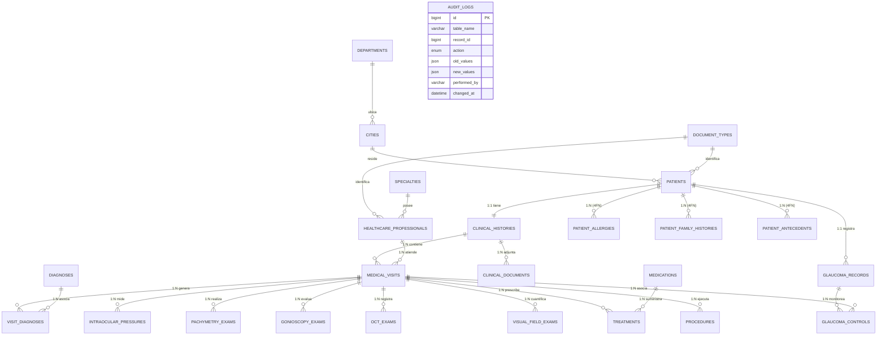

# Sistema de Gestión Integral de Historias Clínicas (Oftalmología y Glaucoma)

**Autor:** Deimer Caro  
**Motor RDBMS:** MySQL 8.0 (InnoDB)  
**Entorno de Ejecución:** Ubuntu Linux — Host `127.0.0.1`, Puerto `3307`  
**Base de Datos:** `oftalmologia_glaucoma_db`  
**Especificación Original:** [`tallerexamenbd.md`](file:///home/camper/Documentos/TALLERDB_DEIMER_CARO/tallerexamenbd.md)  
**Protocolo para Agentes de IA:** [`AGENTS.md`](file:///home/camper/Documentos/TALLERDB_DEIMER_CARO/AGENTS.md)  

---

## 1. Resumen Ejecutivo y Planteamiento del Problema

El presente proyecto implementa una solución relacional integral para la administración clínica, diagnóstico y seguimiento longitudinal de pacientes en el área de **Oftalmología y Glaucoma**. 

El glaucoma representa una de las principales causas mundiales de ceguera irreversible. El control de esta neuropatía óptica exige el seguimiento riguroso y comparativo de variables biométricas por ojo (`OD` = Ojo Derecho, `OI` = Ojo Izquierdo), tales como la **Presión Intraocular (PIO)** mediante tonometría de aplanación Goldmann, la **Paquimetría Corneal Central (CCT)**, la **Gonioscopía** de ángulo iridocorneal, la **Tomografía de Coherencia Óptica (OCT)** de la capa de fibras nerviosas de la retina (CFNR / RNFL) y la **Campimetría Computarizada (Campo Visual)**.

Para resolver los riesgos de inconsistencia, redundancia y pérdida de trazabilidad, el modelo fue estructurado bajo una estricta **normalización hasta la Cuarta Forma Normal (4FN)**, complementado con un banco exhaustivo de **250 ejercicios resueltos** en SQL (consultas, subconsultas, procedimientos, disparadores y funciones), vistas analíticas, eventos programados y compatibilidad nativa con **StarUML**.

---

## 2. Estructura del Repositorio

```
/home/camper/Documentos/TALLERDB_DEIMER_CARO/
├── README.md                          # Este archivo: Documentación maestra del proyecto
├── AGENTS.md                          # Guía de contexto, arquitectura y credenciales para agentes
├── tallerexamenbd.md                  # Enunciado y rúbricas completas del taller/examen
├── .gitignore                         # Exclusiones estándar de Git
│
├── diagrams/                          # Modelos visuales y de herramientas UML
│   ├── oftalmologia_model.mdj         # Proyecto nativo para StarUML 5.x
│   ├── conceptual_model.mmd           # Diagrama Conceptual (Mermaid)
│   ├── logical_model.mmd              # Diagrama Lógico Relacional (Mermaid)
│   └── physical_erd.mmd               # Diagrama Físico DER Completo (Mermaid)
│
├── docs/                              # Documentación técnica paso a paso
│   ├── 01_planteamiento_problema.md   # Justificación clínica, alcance y entidades
│   ├── 02_proceso_normalizacion_4fn.md# Demostración formal de normalización de 0FN a 4FN
│   ├── 03_diccionario_de_datos.md     # Catálogo exhaustivo de tablas, tipos y restricciones
│   └── 04_guia_ejecucion_pruebas.md   # Manual de despliegue y verificación
│
├── sql/                               # Scripts SQL modulares y secuenciales
│   ├── 00_init_database.sql           # CREATE DATABASE utf8mb4 y configuración inicial
│   ├── 01_ddl_schema.sql              # Creación de 25 tablas relacionales, llaves e índices
│   ├── 02_dml_seed_data.sql           # Dataset semilla clínicamente coherente
│   ├── 03_part1_queries.sql           # Parte I: 50 Consultas SQL (Básicas, Intermedias, Avanzadas)
│   ├── 04_part2_subqueries.sql        # Parte II: 50 Subconsultas SQL (Escalares, IN, EXISTS, Correlacionadas)
│   ├── 05_part3_procedures.sql        # Parte III: 50 Procedimientos Almacenados (CRUD y Transaccionales)
│   ├── 06_part4_triggers.sql          # Parte IV: 50 Triggers (BEFORE/AFTER INSERT, UPDATE, DELETE)
│   ├── 07_part5_functions.sql         # Parte V: 50 Funciones Almacenadas (KPIs y clasificaciones)
│   └── 08_views_and_events.sql        # 8 Vistas clínicas y 2 Eventos automáticos
│
└── tests/                             # Suite de pruebas automatizadas
    ├── run_all.sh                     # Runner Bash desatendido de ejecución integral
    └── verify_solutions.sql           # Consultas de verificación y aserciones de integridad
```

---

## 3. Modelo Entidad-Relación (DER)

A continuación se presenta el diagrama físico de la base de datos relacional:



---

## 4. Normalización Rigurosa hasta 4FN

El proceso formal se encuentra detallado en [`docs/02_proceso_normalizacion_4fn.md`](file:///home/camper/Documentos/TALLERDB_DEIMER_CARO/docs/02_proceso_normalizacion_4fn.md):

1. **Primera Forma Normal (1FN):** Eliminación de listas de texto libre y atributos multivaluados en una sola columna. Cada columna almacena valores atómicos.
2. **Segunda Forma Normal (2FN):** Toda tabla con clave primaria compuesta tiene sus atributos no clave dependiendo de la totalidad de la clave y no de una parte (ej. desacoplamiento de diagnósticos y tratamientos respecto a la consulta médica).
3. **Tercera Forma Normal (3FN):** Eliminación de dependencias transitivas. Los catálogos de ciudades (`cities`), departamentos (`departments`), especialidades (`specialties`), tipos de documento (`document_types`), medicamentos (`medications`) y diagnósticos (`diagnoses`) se aislaron de las tablas operativas.
4. **Forma Normal de Boyce-Codd (BCNF):** Toda determinante de una dependencia funcional es una superclave.
5. **Cuarta Forma Normal (4FN):** Eliminación de **Dependencias Multivaluadas Independientes (MVD)**:
   - En el dominio clínico, un paciente tiene un conjunto de *Alergias* ($P \twoheadrightarrow A$), un conjunto de *Antecedentes Familiares* ($P \twoheadrightarrow AF$) y antecedentes personales patológicos ($P \twoheadrightarrow AP$).
   - Dejar estos atributos en una misma tabla generaba anomalías de producto cartesiano y redundancia combinatoria.
   - **Solución 4FN:** Se crearon las tablas aisladas `patient_allergies`, `patient_family_histories` y `patient_antecedents`.

---

## 5. Integración con StarUML

El proyecto incluye un modelo nativo completo en formato StarUML listo para ser abierto e inspeccionado:

- **Archivo del Modelo:** `diagrams/oftalmologia_model.mdj`
- **Ubicación del ejecutable StarUML:** `/usr/bin/staruml`
- **Instrucciones para abrir en StarUML:**
  ```bash
  staruml diagrams/oftalmologia_model.mdj &
  ```
  Al abrir este archivo, StarUML cargará automáticamente el paquete `Oftalmologia_Glaucoma_Model` con sus diagramas de entidades, tipos de datos SQL, relaciones de cardinalidad, llaves primarias (`PK`) y foráneas (`FK`).

---

## 6. Banco de 250 Ejercicios MySQL Implementados

El proyecto da cumplimiento íntegro y verificable a las 5 partes solicitadas:

| Componente | Archivo SQL | Ejercicios | Descripción |
| :--- | :--- | :---: | :--- |
| **Parte I: Consultas SQL** | [`sql/03_part1_queries.sql`](file:///home/camper/Documentos/TALLERDB_DEIMER_CARO/sql/03_part1_queries.sql) | **50** | Consultas Básicas (1-20), Intermedias con `JOIN` (21-40) y Avanzadas con agregaciones, `GROUP BY`, `HAVING` y funciones ventana (41-50). |
| **Parte II: Subconsultas** | [`sql/04_part2_subqueries.sql`](file:///home/camper/Documentos/TALLERDB_DEIMER_CARO/sql/04_part2_subqueries.sql) | **50** | Subconsultas escalares (1-10), operadores `IN` (11-20), cláusulas `NOT IN` / `NOT EXISTS` (21-30), subconsultas correlacionadas (31-40) y avanzadas (41-50). |
| **Parte III: Procedimientos** | [`sql/05_part3_procedures.sql`](file:///home/camper/Documentos/TALLERDB_DEIMER_CARO/sql/05_part3_procedures.sql) | **50** | Procedimientos de consulta y catálogo (1-10), inserción (11-20), actualización (21-30), validaciones con `SIGNAL SQLSTATE` (31-40) y flujos transaccionales con `START TRANSACTION`, `COMMIT` y `ROLLBACK` (41-50). |
| **Parte IV: Triggers** | [`sql/06_part4_triggers.sql`](file:///home/camper/Documentos/TALLERDB_DEIMER_CARO/sql/06_part4_triggers.sql) | **50** | Disparadores `BEFORE INSERT` (1-10), `AFTER INSERT` con auditoría (11-20), `BEFORE UPDATE` para integridad (21-30), `AFTER UPDATE` con alertas clínicas (31-40) y `BEFORE/AFTER DELETE` con tablas de backup (41-50). |
| **Parte V: Funciones** | [`sql/07_part5_functions.sql`](file:///home/camper/Documentos/TALLERDB_DEIMER_CARO/sql/07_part5_functions.sql) | **50** | Funciones escalares y formato (1-10), métricas clínicas (11-20), lógica diagnóstica y completitud (21-30), cálculos estadísticos temporales (31-40) y fichas de resumen textual (41-50). |
| **Vistas y Event Scheduler** | [`sql/08_views_and_events.sql`](file:///home/camper/Documentos/TALLERDB_DEIMER_CARO/sql/08_views_and_events.sql) | **10** | 8 vistas para analítica clínica y 2 eventos programados de mantenimiento preventivo y control de tratamientos. |

---

## 7. Despliegue y Ejecución Automatizada

El proyecto incluye un script de automatización desatendida que reconstruye la base de datos, compila todos los objetos, ejecuta los 250 ejercicios y comprueba las aserciones de calidad.

### Ejecución en un solo comando:

```bash
bash tests/run_all.sh
```

### Parámetros de conexión configurables:
Por defecto, el script se conecta al puerto `3307` con las credenciales del sistema:
```bash
MYSQL_HOST=127.0.0.1 MYSQL_PORT=3307 MYSQL_USER=root MYSQL_PASS=root2026 bash tests/run_all.sh
```

### Resultados de la Verificación:
```
Tablas Relacionales Creadas:        29
Vistas Creadas:                      8
Procedimientos Almacenados Creados: 50
Funciones Almacenadas Creadas:      50
Triggers Creados:                   50
Eventos Programados:                 2
Estado de Ejecución:                100% EXITOSO
```

---

## 8. Licencia y Créditos

Proyecto desarrollado por **Deimer Caro** para el Taller Evaluativo de Bases de Datos Relacionales (Oftalmología y Glaucoma). Código abierto para propósitos académicos y de sustentación técnica.
