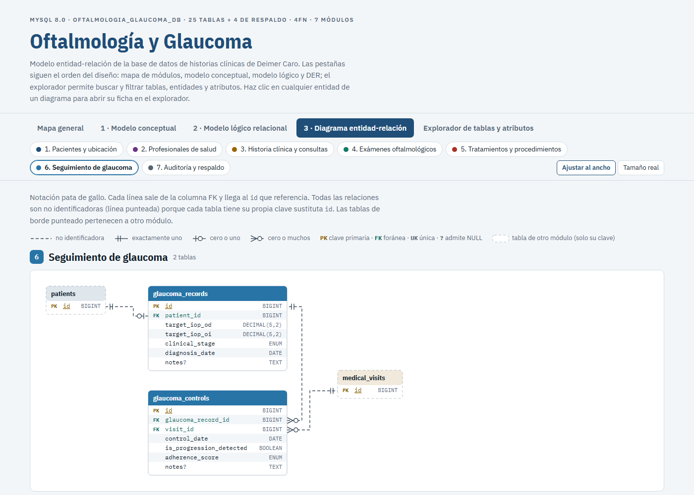
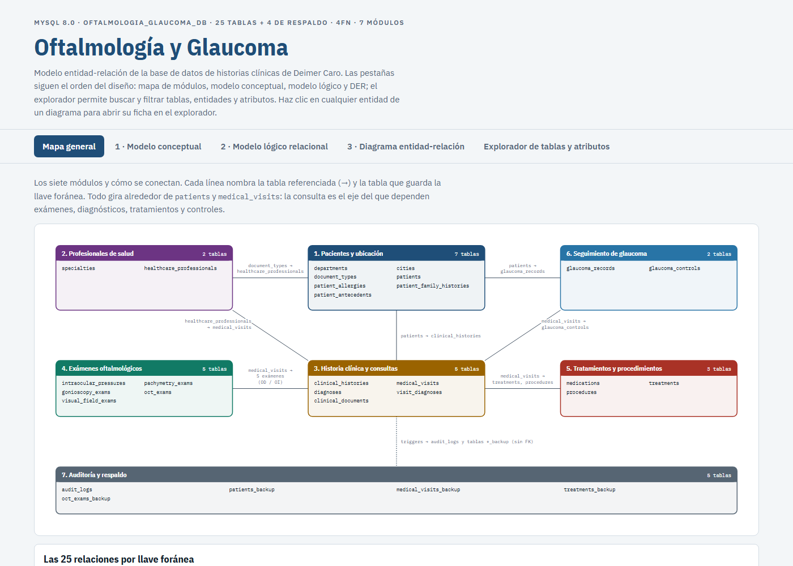
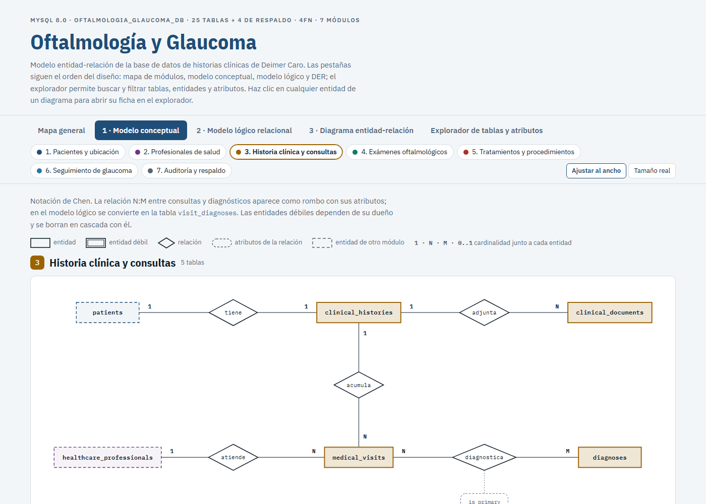
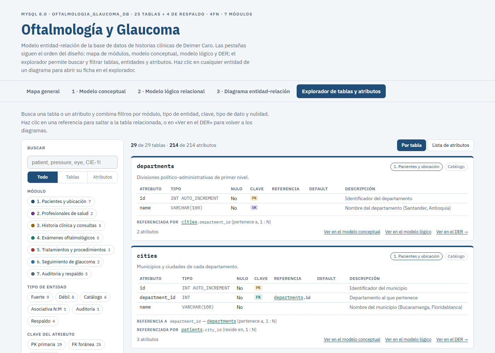
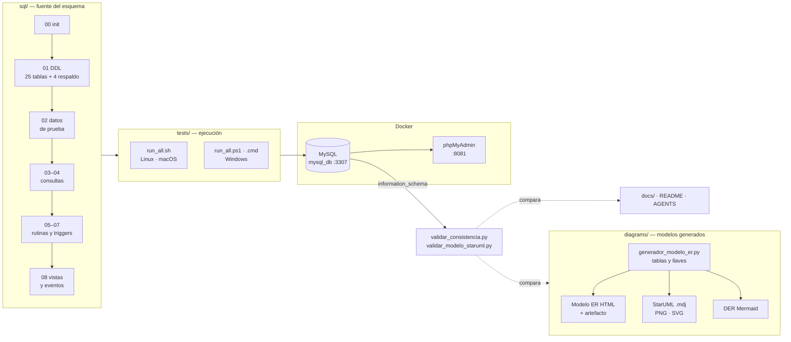
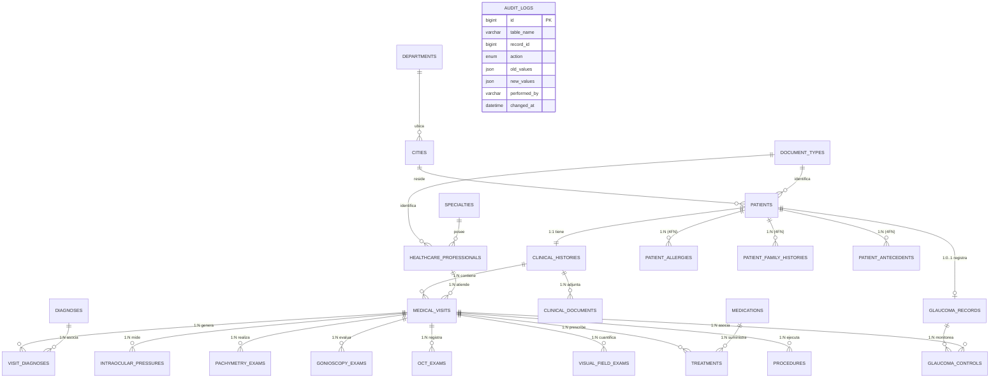
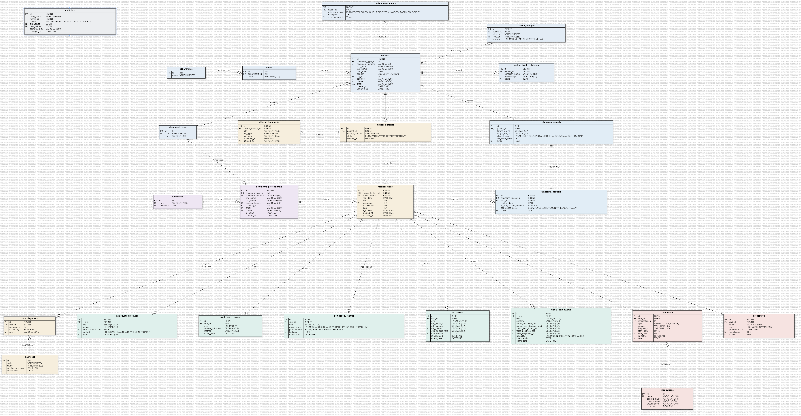

<div align="center">

# Sistema de Gestión de Historias Clínicas
### Oftalmología y Glaucoma · Base de datos relacional en 4FN

**Autor:** Deimer Caro · **Base de datos:** `oftalmologia_glaucoma_db`

[](https://claude.ai/artifact/H6ik4gABMoRhG7E4DRqsis)




</div>

---

## Contenido

1. [Descripción](#descripción)
2. [Modelo ER interactivo](#modelo-er-interactivo)
3. [Tecnologías utilizadas](#tecnologías-utilizadas)
4. [Arquitectura](#arquitectura)
5. [Modelo de datos](#modelo-de-datos)
6. [Banco de 250 ejercicios](#banco-de-250-ejercicios)
7. [Instalación y pruebas](#instalación-y-pruebas)
8. [Validación de consistencia](#validación-de-consistencia)
9. [Estructura del repositorio](#estructura-del-repositorio)
10. [Documentación](#documentación)

---

## Descripción

El glaucoma es una de las principales causas de ceguera irreversible. Su control exige seguir en el tiempo, y **por cada ojo** (`OD` derecho, `OI` izquierdo), la presión intraocular, el espesor corneal, el ángulo iridocorneal, la capa de fibras nerviosas de la retina y el campo visual.

Este proyecto diseña, normaliza hasta la **Cuarta Forma Normal (4FN)**, documenta e implementa en **MySQL** la base de datos de historias clínicas de una consulta de oftalmología y glaucoma. Incluye además:

- los modelos conceptual, lógico y físico;
- un banco de **250 ejercicios resueltos**: consultas, subconsultas, procedimientos, triggers y funciones;
- pruebas automatizadas que funcionan en Windows, Linux y macOS.

| Elemento | Cantidad | Elemento | Cantidad |
|---|---:|---|---:|
| Tablas relacionales | 25 | Procedimientos almacenados | 50 |
| Tablas de respaldo | 4 | Funciones almacenadas | 50 |
| Columnas | 214 | Triggers | 50 |
| Llaves foráneas | 25 | Vistas | 8 |
| Restricciones `CHECK` | 17 | Eventos programados | 2 |
| Índices | 81 | Consultas y subconsultas | 100 |

> Cifras tomadas de `information_schema` tras ejecutar `tests/run_all` (MySQL 8.4.11 en Docker).

---

## Modelo ER interactivo

**→ [Abrir el modelo ER interactivo](https://claude.ai/artifact/H6ik4gABMoRhG7E4DRqsis)** · también se abre sin conexión: [`diagrams/modelo_entidad_relacion.html`](diagrams/modelo_entidad_relacion.html)

Es una sola página organizada en 7 módulos y 5 pestañas:

| Pestaña | Contenido |
|---|---|
| Mapa general | Cómo se conectan los módulos y tabla con las 25 llaves foráneas, su cardinalidad y su `ON DELETE` |
| 1 · Modelo conceptual | Notación de Chen: entidades, entidades débiles, relaciones y cardinalidades |
| 2 · Modelo lógico relacional | Ficha de cada tabla con tipos, nulidad, claves, valores por defecto y restricciones |
| 3 · Diagrama entidad-relación | Notación pata de gallo: cada línea une la columna FK con el `id` que referencia |
| Explorador de tablas y atributos | Búsqueda y filtros por módulo, tipo de entidad, clave, tipo de dato y nulidad |

Al hacer clic en una entidad de cualquier diagrama se abre su ficha en el explorador, y desde cada ficha se vuelve al diagrama de su módulo.

| Mapa general | Modelo conceptual (Chen) | Explorador |
|:---:|:---:|:---:|
|  |  |  |

---

## Tecnologías utilizadas

<p align="center">
  
</p>

| Tecnología | Uso en el proyecto |
|---|---|
|  | Motor relacional InnoDB: esquema 4FN, procedimientos, funciones, triggers, vistas y eventos |
|  | Contenedor `mysql_db` (puerto `3307`) y `phpmyadmin` (puerto `8081`); las pruebas usan `docker exec` cuando no hay cliente MySQL local |
|  | Exploración visual de tablas, rutinas, triggers y del diseñador de relaciones |
|  | Modelo lógico nativo (`.mdj`) con 8 diagramas y exportaciones PNG/SVG |
|  | Diagramas como código: conceptual, lógico y DER físico |
|  | Modelo conceptual editable |
|  | Generadores de diagramas (`diagrams/generador_*.py`) y validadores (`tests/validar_*.py`) |
|  | Modelo ER interactivo con explorador y navegación entre vistas |
|   | Lanzadores de despliegue y pruebas para Linux, macOS y Windows |
|  | Control de versiones con *Conventional Commits* y `.gitattributes` para los finales de línea |

---

## Arquitectura



- **El esquema nace en `sql/`.** Los lanzadores de `tests/` lo despliegan en MySQL y ejecutan los 250 ejercicios y las aserciones.
- **Los diagramas se generan desde una sola fuente** (`diagrams/generador_modelo_er.py`), así el HTML, StarUML y Mermaid no se contradicen.
- **La base desplegada es la fuente de verdad:** los validadores leen `information_schema` y comparan contra ella cada diagrama, documento y script.

### Módulos del modelo

| # | Módulo | Tablas |
|---|---|---|
| 1 | Pacientes y ubicación | `departments`, `cities`, `document_types`, `patients`, `patient_allergies`, `patient_family_histories`, `patient_antecedents` |
| 2 | Profesionales de salud | `specialties`, `healthcare_professionals` |
| 3 | Historia clínica y consultas | `clinical_histories`, `medical_visits`, `diagnoses`, `visit_diagnoses`, `clinical_documents` |
| 4 | Exámenes oftalmológicos | `intraocular_pressures`, `pachymetry_exams`, `gonioscopy_exams`, `oct_exams`, `visual_field_exams` |
| 5 | Tratamientos y procedimientos | `medications`, `treatments`, `procedures` |
| 6 | Seguimiento de glaucoma | `glaucoma_records`, `glaucoma_controls` |
| 7 | Auditoría y respaldo | `audit_logs`, `patients_backup`, `medical_visits_backup`, `treatments_backup`, `oct_exams_backup` |

---

## Modelo de datos

### Diagrama entidad-relación



El DER completo, con los 214 atributos y sus tipos, está en [`diagrams/physical_erd.mmd`](diagrams/physical_erd.mmd).

### Normalización hasta 4FN

| Forma normal | Qué se resolvió en este modelo |
|---|---|
| **1FN** | Listas de alergias, diagnósticos y medicamentos separadas en filas atómicas |
| **2FN** | Catálogos `diagnoses` y `medications` fuera de `visit_diagnoses` y `treatments` |
| **3FN** | Catálogos `cities`, `departments`, `specialties` y `document_types` para eliminar dependencias transitivas |
| **BCNF** | Todo determinante es clave: `id` o una clave candidata `UNIQUE` (`document_number`, `history_number`, …) |
| **4FN** | Las dependencias multivaluadas del paciente (alergias, antecedentes familiares y personales) van en tres tablas independientes |

Demostración paso a paso en [`docs/02_proceso_normalizacion_4fn.md`](docs/02_proceso_normalizacion_4fn.md); detalle de cada columna en el [diccionario de datos](docs/03_diccionario_de_datos.md).

### Modelo lógico en StarUML

[`diagrams/oftalmologia_model.mdj`](diagrams/oftalmologia_model.mdj) contiene:

- **29 entidades y 214 columnas**, cada una con su tipo y sus marcas **PK**, **FK** (con la columna a la que apunta), **U** (UNIQUE) y **N** (admite NULL);
- **25 relaciones** con cardinalidad `1 : 0..*` o `1 : 0..1`;
- **8 diagramas**: uno completo y uno por módulo.



| Diagrama | PNG | SVG |
|---|---|---|
| 0. Modelo lógico completo | [PNG](diagrams/exportaciones_staruml/0_modelo_logico_completo.png) | [SVG](diagrams/exportaciones_staruml/0_modelo_logico_completo.svg) |
| 1. Pacientes y ubicación | [PNG](diagrams/exportaciones_staruml/1_pacientes_y_ubicacion.png) | [SVG](diagrams/exportaciones_staruml/1_pacientes_y_ubicacion.svg) |
| 2. Profesionales de salud | [PNG](diagrams/exportaciones_staruml/2_profesionales_de_salud.png) | [SVG](diagrams/exportaciones_staruml/2_profesionales_de_salud.svg) |
| 3. Historia clínica y consultas | [PNG](diagrams/exportaciones_staruml/3_historia_clinica_y_consultas.png) | [SVG](diagrams/exportaciones_staruml/3_historia_clinica_y_consultas.svg) |
| 4. Exámenes oftalmológicos | [PNG](diagrams/exportaciones_staruml/4_examenes_oftalmologicos.png) | [SVG](diagrams/exportaciones_staruml/4_examenes_oftalmologicos.svg) |
| 5. Tratamientos y procedimientos | [PNG](diagrams/exportaciones_staruml/5_tratamientos_y_procedimientos.png) | [SVG](diagrams/exportaciones_staruml/5_tratamientos_y_procedimientos.svg) |
| 6. Seguimiento de glaucoma | [PNG](diagrams/exportaciones_staruml/6_seguimiento_de_glaucoma.png) | [SVG](diagrams/exportaciones_staruml/6_seguimiento_de_glaucoma.svg) |
| 7. Auditoría y respaldo | [PNG](diagrams/exportaciones_staruml/7_auditoria_y_respaldo.png) | [SVG](diagrams/exportaciones_staruml/7_auditoria_y_respaldo.svg) |

**Abrir en StarUML:** Windows, **File → Open…**; macOS, `open -a StarUML diagrams/oftalmologia_model.mdj`; Linux, `staruml diagrams/oftalmologia_model.mdj &`.

### Otros modelos

| Modelo | Archivo |
|---|---|
| Conceptual (Mermaid) | [`diagrams/conceptual_model.mmd`](diagrams/conceptual_model.mmd) |
| Conceptual (draw.io) | [`diagrams/modelo_conceptual.drawio`](diagrams/modelo_conceptual.drawio), se abre en [app.diagrams.net](https://app.diagrams.net/) |
| Lógico (Mermaid) | [`diagrams/logical_model.mmd`](diagrams/logical_model.mmd) |
| Físico (Mermaid) | [`diagrams/physical_erd.mmd`](diagrams/physical_erd.mmd) |

---

## Banco de 250 ejercicios

| Parte | Archivo | Ejercicios | Contenido |
|---|---|:---:|---|
| I · Consultas | [`sql/03_part1_queries.sql`](sql/03_part1_queries.sql) | 50 | Básicas (1–20); intermedias con `JOIN` (21–40); avanzadas con agregación, `GROUP BY` y `HAVING` (41–50) |
| II · Subconsultas | [`sql/04_part2_subqueries.sql`](sql/04_part2_subqueries.sql) | 50 | Escalares (1–10), `IN` (11–20), `NOT IN` y `NOT EXISTS` (21–30), correlacionadas (31–40) y avanzadas (41–50) |
| III · Procedimientos | [`sql/05_part3_procedures.sql`](sql/05_part3_procedures.sql) | 50 | Consulta (1–10), inserción (11–20), modificación (21–30), validaciones con `SIGNAL SQLSTATE` (31–40) y transacciones con `START TRANSACTION`, `COMMIT`, `ROLLBACK` y `EXIT HANDLER` (41–50) |
| IV · Triggers | [`sql/06_part4_triggers.sql`](sql/06_part4_triggers.sql) | 50 | `BEFORE INSERT` (1–10), `AFTER INSERT` con auditoría JSON (11–20), `BEFORE UPDATE` (21–30), `AFTER UPDATE` con alertas (31–40), `DELETE` con respaldo y auditoría (41–50) |
| V · Funciones | [`sql/07_part5_functions.sql`](sql/07_part5_functions.sql) | 50 | Básicas (1–10), con consultas (11–20), clínicas y de clasificación (21–30), estadísticas y temporales (31–40), avanzadas (41–50) |
| Vistas y eventos | [`sql/08_views_and_events.sql`](sql/08_views_and_events.sql) | 8 + 2 | Vistas `vw_*` de analítica clínica; eventos diario y semanal de mantenimiento |

Los 250 ejercicios, con su enunciado y su solución, también están en el documento de entrega [`tallerexamenbd.md`](tallerexamenbd.md).

---

## Instalación y pruebas

### Requisitos

| Requisito | Detalle |
|---|---|
| MySQL 8.0 o superior | Contenedor Docker `mysql_db` publicado en `3307` **o** un servidor MySQL accesible |
| Cliente para ejecutar los scripts | **Docker** (las pruebas usan `docker exec`, sin instalar MySQL) **o** el cliente `mysql` en el `PATH` |
| Python 3 | Solo para los validadores y los generadores de diagramas |

### Procedimiento

1. **Levante MySQL y phpMyAdmin** desde la carpeta de su `docker-compose`:
   ```bash
   docker compose up -d mysql_db phpmyadmin
   ```
2. **Clone el repositorio** y entre en él:
   ```bash
   git clone <url-del-repositorio> DB_DEIMER_CARO && cd DB_DEIMER_CARO
   ```
3. **Despliegue y pruebe** con el lanzador de su sistema. El script crea la base, carga el esquema y los datos, compila los 250 ejercicios y ejecuta las aserciones finales:

| Sistema | Comando |
|---|---|
|  | `bash tests/run_all.sh` |
|  | `bash tests/run_all.sh` |
|  | `powershell -ExecutionPolicy Bypass -File tests\run_all.ps1` |
|  | `tests\run_all.cmd` (también con doble clic) |
|  | `bash tests/run_all.sh` |

4. **Valide los modelos y la documentación** contra la base desplegada:
   ```bash
   python tests/validar_consistencia.py --resumen
   ```
5. **Explore la base** en phpMyAdmin: `http://localhost:8081` (servidor `mysql_db`, usuario `root`).

### Configuración de la conexión

Todos los lanzadores y validadores leen las mismas variables de entorno:

| Variable | Por defecto | Descripción |
|---|---|---|
| `MYSQL_MODE` | `auto` | `auto` usa el cliente local si existe y, si no, Docker; `local` o `docker` lo fuerzan |
| `MYSQL_CONTAINER` | `mysql_db` | Contenedor en modo `docker` |
| `MYSQL_HOST` / `MYSQL_PORT` | `127.0.0.1` / `3307` | Servidor en modo `local` |
| `MYSQL_USER` / `MYSQL_PASS` | `root` / `root2026` | Credenciales |
| `MYSQL_DB` | `oftalmologia_glaucoma_db` | Base de datos |

```bash
MYSQL_MODE=docker bash tests/run_all.sh                                   # Linux / macOS
```
```powershell
$env:MYSQL_MODE = "docker"; powershell -ExecutionPolicy Bypass -File tests\run_all.ps1   # Windows
```

### Resultados de las pruebas

| Entorno | Cómo se probó | Resultado |
|---|---|---|
| Windows 11 · PowerShell / CMD | `tests\run_all.cmd` en modo Docker | ✅ 9/9 pasos · aserciones correctas (6 s) |
| Windows 11 · Git Bash | `bash tests/run_all.sh` en modo Docker | ✅ 9/9 pasos |
| Linux · bash 5.1 | `run_all.sh` dentro de un contenedor Linux (`mysql:8.4`) en la red de `mysql_db` | ✅ 9/9 pasos |
| macOS · bash 3.2 | `run_all.sh` con la misma versión de bash que trae macOS (imagen `bash:3.2`) | ✅ 9/9 pasos |
| Validación de consistencia | `python tests/validar_consistencia.py` | ✅ 0 errores en 33 artefactos |
| Modelo StarUML | `python tests/validar_modelo_staruml.py` | ✅ 29 entidades, 214 columnas, 25 relaciones |
| Documento de entrega | `python scripts/verify_tallerexamenbd.py` | ✅ 250 ejercicios con su bloque SQL |

```text
 [EJECUTANDO] Paso 1: Inicialización de Base de Datos (sql/00_init_database.sql)... [OK]
 [EJECUTANDO] Paso 2: Creación de Esquema Físico DDL (sql/01_ddl_schema.sql)... [OK]
 ...
 [EJECUTANDO] Paso 9: Creación de Vistas y Eventos (sql/08_views_and_events.sql)... [OK]
TODAS LAS VALIDACIONES COMPLETADAS EXITOSAMENTE
  DESPLIEGUE Y PRUEBAS COMPLETADAS SATISFACTORIAMENTE AL 100%
```

### Solución de problemas

| Síntoma | Causa y solución |
|---|---|
| `$'\r': command not found` al ejecutar `run_all.sh` | El script tiene finales de línea de Windows. `.gitattributes` lo evita en clones nuevos; en un clon antiguo: `rm tests/run_all.sh && git checkout -- tests/run_all.sh` |
| `El contenedor 'mysql_db' no está en ejecución` | Inicie el contenedor: `docker start mysql_db` o `docker compose up -d` |
| macOS sin cliente `mysql` | Use Docker (modo `auto`) o instale el cliente: `brew install mysql-client` |
| `Plugin caching_sha2_password could not be loaded` | El cliente MariaDB no trae el plugin de MySQL 8: use el cliente oficial de MySQL o el modo `docker` |

---

## Validación de consistencia

`tests/validar_consistencia.py` toma la base desplegada como fuente de verdad (`information_schema`) y comprueba que **todo el repositorio dice lo mismo**:

| Artefacto | Qué se compara |
|---|---|
| `sql/01_ddl_schema.sql` y su copia en `tallerexamenbd.md` | Tablas, columnas, tipos, `NULL`, `DEFAULT`, PK, UNIQUE, FK y `CHECK` |
| `sql/02`–`08`, `tests/verify_solutions.sql` | Que cada columna usada en `INSERT`, `UPDATE`, `NEW.`/`OLD.` y `alias.columna` exista |
| `docs/03_diccionario_de_datos.md` | Cada columna con su tipo, nulidad, claves y valor por defecto |
| Diagramas Mermaid, draw.io y este README | Entidades, atributos, tipos y cardinalidad de las 25 relaciones |
| Modelo ER HTML y el artefacto publicado | Datos del explorador, fichas del modelo lógico, DER, Chen y tabla de relaciones |
| StarUML `.mdj` y sus exportaciones SVG | Entidades, columnas en orden, tipos, marcas PK/FK/U/N y relaciones de cada diagrama |
| Textos de `docs/`, README y AGENTS | Nombres de tabla citados y rangos de `CHECK` descritos |

Termina con código 1 si encuentra cualquier diferencia. Para validar también la versión publicada del artefacto, pase la ruta de una copia descargada: `python tests/validar_consistencia.py ruta/al/artefacto.html`.

**Si cambia el DDL:** actualice las tablas (`T`) y llaves (`FKS`) en `diagrams/generador_modelo_er.py`, regenere los modelos y vuelva a validar:

```bash
python diagrams/generador_modelo_er.py diagrams/modelo_entidad_relacion.html diagrams/plantilla_modelo_er.html
python diagrams/generador_staruml.py   diagrams/oftalmologia_model.mdj
python diagrams/generador_mermaid.py   diagrams/physical_erd.mmd
python tests/validar_consistencia.py --resumen
```

---

## Estructura del repositorio

```
DB_DEIMER_CARO/
├── README.md                          # Este documento
├── AGENTS.md                          # Contexto, decisiones y estado para agentes de IA
├── tallerexamenbd.md                  # Enunciado del taller y documento de entrega con los 250 ejercicios
├── .gitattributes                     # LF en .sh/.sql y CRLF en .ps1/.cmd
├── .gitignore
│
├── sql/                               # Scripts en orden de ejecución
│   ├── 00_init_database.sql           # Base de datos utf8mb4 y event_scheduler
│   ├── 01_ddl_schema.sql              # 25 tablas, 4 de respaldo, llaves, CHECK e índices
│   ├── 02_dml_seed_data.sql           # Datos clínicos de prueba
│   ├── 03_part1_queries.sql           # Parte I: 50 consultas
│   ├── 04_part2_subqueries.sql        # Parte II: 50 subconsultas
│   ├── 05_part3_procedures.sql        # Parte III: 50 procedimientos
│   ├── 06_part4_triggers.sql          # Parte IV: 50 triggers
│   ├── 07_part5_functions.sql         # Parte V: 50 funciones
│   └── 08_views_and_events.sql        # 8 vistas y 2 eventos
│
├── diagrams/
│   ├── modelo_entidad_relacion.html   # Modelo ER interactivo (versión local del artefacto)
│   ├── plantilla_modelo_er.html       # Estilos, navegación y explorador de la página
│   ├── generador_modelo_er.py         # Fuente única de tablas y llaves; genera el HTML
│   ├── oftalmologia_model.mdj         # Modelo lógico StarUML (29 entidades, 8 diagramas)
│   ├── generador_staruml.py           # Genera el .mdj
│   ├── physical_erd.mmd               # DER físico completo en Mermaid
│   ├── generador_mermaid.py           # Genera physical_erd.mmd
│   ├── logical_model.mmd              # Modelo lógico en Mermaid
│   ├── conceptual_model.mmd           # Modelo conceptual en Mermaid
│   ├── modelo_conceptual.drawio       # Modelo conceptual en draw.io
│   └── exportaciones_staruml/         # Los 8 diagramas de StarUML en PNG y SVG
│
├── docs/
│   ├── 01_planteamiento_problema.md   # Problema, objetivos y alcance
│   ├── 02_proceso_normalizacion_4fn.md# Normalización de 0FN a 4FN
│   ├── 03_diccionario_de_datos.md     # Diccionario de las 29 tablas
│   ├── 04_guia_ejecucion_pruebas.md   # Guía de despliegue, phpMyAdmin, StarUML y draw.io
│   ├── 05_ruta_de_aprendizaje.md      # Ruta de aprendizaje de los temas del proyecto
│   └── img/                           # Capturas del modelo ER interactivo
│
├── scripts/
│   ├── build_tallerexamenbd.py        # Inserta los SQL en tallerexamenbd.md
│   └── verify_tallerexamenbd.py       # Comprueba que tallerexamenbd.md tenga los 250 ejercicios
│
└── tests/
    ├── run_all.sh                     # Despliegue y pruebas: Linux, macOS, Git Bash, WSL
    ├── run_all.ps1                    # Despliegue y pruebas: Windows PowerShell
    ├── run_all.cmd                    # Atajo para Windows (CMD o doble clic)
    ├── verify_solutions.sql           # Aserciones finales sobre la base
    ├── validar_modelo_staruml.py      # Compara el .mdj con la base
    └── validar_consistencia.py        # Compara todo el repositorio con la base
```

---

## Documentación

| Documento | Contenido |
|---|---|
| [01 · Planteamiento del problema](docs/01_planteamiento_problema.md) | Situación clínica, pregunta problema, objetivos y alcance |
| [02 · Normalización hasta 4FN](docs/02_proceso_normalizacion_4fn.md) | Dependencias funcionales y multivaluadas, de 0FN a 4FN |
| [03 · Diccionario de datos](docs/03_diccionario_de_datos.md) | Las 29 tablas con tipos, nulidad, claves y valores por defecto |
| [04 · Guía de ejecución y pruebas](docs/04_guia_ejecucion_pruebas.md) | Contenedor, phpMyAdmin, StarUML, draw.io y validación |
| [05 · Ruta de aprendizaje](docs/05_ruta_de_aprendizaje.md) | Recorrido por los temas del proyecto: glaucoma, modelado, normalización, MySQL, pruebas y herramientas |
| [Taller y entrega](tallerexamenbd.md) | Enunciado original y los 250 ejercicios resueltos |
| [AGENTS.md](AGENTS.md) | Contexto técnico para continuar el proyecto con agentes de IA |

---

<div align="center">

Proyecto académico desarrollado por **Deimer Caro** para el Taller Evaluativo de Bases de Datos Relacionales.

</div>
