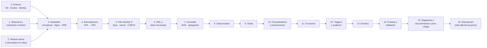

# 5. Ruta de Aprendizaje del Proyecto

Esta ruta recorre, en orden, todos los temas que se trabajan en el proyecto **Sistema de Gestión de Historias Clínicas — Oftalmología y Glaucoma**: el dominio clínico, el diseño de bases de datos, MySQL 8 y las herramientas usadas para probar y documentar. Cada etapa indica **qué aprender**, **dónde verlo aplicado en este repositorio**, **una práctica** y **cómo comprobar** que se domina.

> **Aviso:** el contenido clínico es divulgativo y sirve para entender el modelo de datos. No sustituye la formación médica ni las guías clínicas oficiales.

---

## 5.1. Cómo usar esta ruta

- **Orden:** las etapas están ordenadas por dependencia. La 1 y la 2 (dominio) pueden estudiarse en paralelo con la 3 y la 4 (modelado).
- **Dedicación estimada:** unas **70–90 horas** en total, a razón de 6–10 horas por semana (10–12 semanas).
- **Prerrequisitos:** manejo básico de la terminal y nociones de lógica de programación.
- **Entorno de práctica:** despliegue la base con `tests/run_all.*` (ver [README](../README.md#instalación-y-pruebas)) y use phpMyAdmin (`http://localhost:8081`) o el cliente `mysql` para cada práctica. Para volver al estado inicial basta con ejecutar de nuevo `run_all`.

| Etapa | Tema | Horas | Archivos de referencia |
|---|---|---:|---|
| 0 | Entorno de trabajo | 3 | `tests/run_all.*`, `.gitattributes` |
| 1 | Glaucoma y exámenes oftalmológicos | 8 | `sql/02_dml_seed_data.sql`, `docs/01` |
| 2 | Historia clínica e informática en salud | 3 | `clinical_histories`, `audit_logs` |
| 3 | Modelado de datos | 7 | `diagrams/`, `docs/03` |
| 4 | Normalización hasta 4FN | 6 | `docs/02_proceso_normalizacion_4fn.md` |
| 5 | DDL en MySQL 8 | 6 | `sql/00`, `sql/01` |
| 6 | DML y datos de prueba | 3 | `sql/02_dml_seed_data.sql` |
| 7 | Consultas | 6 | `sql/03_part1_queries.sql` |
| 8 | Subconsultas | 6 | `sql/04_part2_subqueries.sql` |
| 9 | Vistas | 2 | `sql/08_views_and_events.sql` |
| 10 | Procedimientos y transacciones | 7 | `sql/05_part3_procedures.sql` |
| 11 | Funciones almacenadas | 4 | `sql/07_part5_functions.sql` |
| 12 | Triggers y auditoría | 6 | `sql/06_part4_triggers.sql` |
| 13 | Eventos programados | 2 | `sql/08_views_and_events.sql` |
| 14 | Pruebas y validación | 5 | `tests/` |
| 15 | Diagramas y documentación como código | 5 | `diagrams/generador_*.py` |
| 16 | Extensiones | 8+ | — |

---

## Etapa 0. Entorno de trabajo

**Objetivo:** levantar la base de datos y ejecutar el proyecto en cualquier sistema operativo.

**Temas**
- Git: commits, ramas, historial, mensajes *Conventional Commits* (`feat:`, `fix:`, `docs:`, `test:`).
- Finales de línea **LF/CRLF** y por qué `bash` falla con `$'\r': command not found`; cómo lo resuelve `.gitattributes`.
- Docker: imágenes, contenedores, puertos (`3307:3306`), redes y `docker exec`.
- Cliente `mysql`, phpMyAdmin y variables de entorno de conexión.

**En el proyecto:** `tests/run_all.sh` (Linux/macOS), `tests/run_all.ps1` y `tests/run_all.cmd` (Windows), `.gitattributes`.

**Práctica:** ejecute `run_all` en su sistema, luego fuerce `MYSQL_MODE=docker` y después `MYSQL_MODE=local`. Explique la diferencia.

**Autoevaluación**
- ¿Por qué el script funciona aunque el equipo no tenga MySQL instalado?
- ¿Qué hace `docker exec -i mysql_db mysql … < archivo.sql`?

---

## Etapa 1. Dominio clínico: oftalmología y glaucoma

**Objetivo:** entender qué mide cada examen y por qué el modelo guarda cada dato **por ojo** (`OD` derecho, `OI` izquierdo).

### 1.1. Conceptos base
- **Anatomía relevante:** córnea, cámara anterior, ángulo iridocorneal, malla trabecular, nervio óptico y capa de fibras nerviosas de la retina (RNFL).
- **Humor acuoso:** se produce en el cuerpo ciliar y drena por el ángulo. Si el drenaje falla, sube la **presión intraocular (PIO)**.
- **Glaucoma:** neuropatía óptica progresiva que daña el nervio óptico y produce pérdida de campo visual irreversible. La PIO elevada es su principal factor de riesgo modificable (rango poblacional habitual: aproximadamente 10–21 mmHg).
- **Tipos** (codificados con CIE-10 en `diagnoses`):

| Código | Diagnóstico | Idea clave |
|---|---|---|
| H40.0 | Sospecha de glaucoma | Hallazgos de riesgo sin daño confirmado |
| H40.1 | Glaucoma primario de ángulo abierto | El ángulo está abierto pero el drenaje es insuficiente; avanza sin síntomas |
| H40.2 | Glaucoma primario de ángulo cerrado | El iris bloquea el ángulo; puede causar crisis aguda |
| H40.5 | Glaucoma secundario | Causado por otra enfermedad ocular |

### 1.2. Exámenes y cómo se modelan

| Examen | Qué mide | Tabla y columnas | Restricción en la base |
|---|---|---|---|
| **Tonometría** | Presión intraocular (mmHg) con Goldmann, aire, Perkins o iCare | `intraocular_pressures.pressure`, `method`, `measurement_time` | `CHECK pressure > 0 AND <= 80` |
| **Paquimetría** | Espesor corneal central (CCT, µm). Una córnea delgada hace que la tonometría **subestime** la PIO real | `pachymetry_exams.corneal_thickness` | `CHECK > 0 AND <= 1000` |
| **Gonioscopía** | Apertura del ángulo según **Shaffer**: grado 0 (cerrado) a IV (abierto) | `gonioscopy_exams.angle_grade`, `pigmentation` | `ENUM('GRADO 0' … 'GRADO IV')` |
| **OCT** | Espesor de la RNFL (promedio, superior, inferior) y relación **excavación/disco** | `oct_exams.rnfl_average`, `cup_to_disc_ratio` | `rnfl_average` 0–300; `cup_to_disc_ratio` 0–1 |
| **Campo visual** (SITA 24-2) | **MD** (desviación media, dB), **PSD** (desviación del patrón) y **VFI** (% de función visual) | `visual_field_exams.mean_deviation_md`, `pattern_std_deviation_psd`, `visual_field_index_vfi`, `reliability` | `VFI` 0–100 |

- **Estadificación:** el estadio (`glaucoma_records.clinical_stage`: SOSPECHA, INICIAL, MODERADO, AVANZADO, TERMINAL) combina daño estructural (OCT, excavación) y funcional (campo visual). Una referencia clásica para el campo visual es la de Hodapp-Parrish-Anderson: temprano MD > −6 dB, moderado entre −6 y −12 dB, avanzado < −12 dB.
- **Confiabilidad del campo visual:** muchos falsos positivos o falsos negativos invalidan la prueba (`false_positives_pct`, `false_negatives_pct`, `reliability`).
- **PIO objetivo:** meta individual por ojo, muchas veces una reducción del 20–30 % respecto a la PIO basal (`target_iop_od`, `target_iop_oi`, con `CHECK > 0 AND <= 50`).

### 1.3. Tratamiento y seguimiento
- **Fármacos hipotensores** (`medications`, `treatments`):
  - análogos de prostaglandinas (latanoprost, bimatoprost, travoprost): aumentan el drenaje uveoescleral; suelen ser primera línea;
  - betabloqueadores (timolol): reducen la producción de humor acuoso; precaución en asma y bradicardia;
  - inhibidores de la anhidrasa carbónica (dorzolamida tópica, acetazolamida oral): reducen la producción;
  - agonistas alfa-2 (brimonidina): reducen la producción y aumentan el drenaje.
- **Procedimientos** (`procedures`): trabeculoplastia láser selectiva (SLT), iridotomía periférica con láser Nd:YAG (ángulo cerrado), trabeculectomía con mitomicina C (cirugía filtrante) y facoemulsificación.
- **Seguimiento** (`glaucoma_controls`): progresión detectada (`is_progression_detected`) y adherencia a las gotas (`adherence_score`). La mala adherencia es una causa frecuente de progresión.

**Práctica:** con los datos de prueba, liste para cada paciente con glaucoma su última PIO por ojo y compárela con su PIO objetivo. ¿Quién está por encima de la meta?

**Autoevaluación**
- ¿Por qué `intraocular_pressures` tiene una fila por ojo y no dos columnas `pio_od` y `pio_oi`?
- ¿Por qué un tratamiento sí admite `eye = 'AMBOS'` y un examen no?

---

## Etapa 2. Historia clínica e informática en salud

**Objetivo:** entender las reglas del expediente clínico que el modelo hace cumplir.

**Temas**
- Expediente **único por paciente** (`clinical_histories.patient_id` es `UNIQUE`: relación 1:1).
- Consulta (`medical_visits`) como eje: diagnósticos, exámenes, tratamientos y controles cuelgan de ella.
- **Trazabilidad y no repudio:** bitácora inmutable (`audit_logs` con valores anteriores y nuevos en JSON) y tablas `*_backup` antes de cada borrado.
- **Integridad:** borrados en cascada solo donde el dato no tiene sentido sin su padre (`ON DELETE CASCADE`) y bloqueo del borrado en el resto (`RESTRICT`).
- **Marco normativo colombiano** (para profundizar): Resolución 1995 de 1999 (manejo de la historia clínica), Ley 1581 de 2012 (protección de datos personales) y Ley 2015 de 2020 (historia clínica electrónica interoperable). Codificación de diagnósticos con **CIE-10**.

**En el proyecto:** `sql/06_part4_triggers.sql` (auditoría y respaldos), `docs/01_planteamiento_problema.md`.

**Práctica:** actualice un tratamiento y consulte `audit_logs` para ver el registro que generó el trigger.

**Autoevaluación:** ¿por qué la historia clínica usa `ON DELETE RESTRICT` hacia el paciente y los exámenes `ON DELETE CASCADE` hacia la consulta?

---

## Etapa 3. Modelado de datos

**Objetivo:** pasar de la realidad clínica a un modelo conceptual, lógico y físico.

**Temas**
- **Modelo conceptual (Chen):** entidades, atributos, relaciones, cardinalidad (1, N, M, 0..1), entidades débiles y relaciones N:M con atributos.
- **Modelo lógico relacional:** notación `tabla(PK, FK#, …)`, resolución de N:M con tablas asociativas (`visit_diagnoses`).
- **DER físico (pata de gallo):** relaciones identificadoras y no identificadoras, opcionalidad (círculo) y multiplicidad (pata de gallo).
- Claves sustitutas (`id AUTO_INCREMENT`) frente a claves naturales (`document_number`, `history_number`) y claves candidatas (`UNIQUE`).

**En el proyecto**
- Conceptual: `diagrams/conceptual_model.mmd`, `diagrams/modelo_conceptual.drawio`.
- Lógico y DER: `diagrams/oftalmologia_model.mdj` (StarUML), `diagrams/physical_erd.mmd`, `diagrams/exportaciones_staruml/`.
- Interactivo: `diagrams/modelo_entidad_relacion.html` ([versión publicada](https://claude.ai/artifact/H6ik4gABMoRhG7E4DRqsis)).
- Diccionario: `docs/03_diccionario_de_datos.md`.

**Práctica:** dibuje a mano el módulo de glaucoma (paciente, ficha, controles, consulta) con sus cardinalidades y compárelo con el diagrama `6. Seguimiento de glaucoma`.

**Autoevaluación:** ¿por qué paciente–ficha de glaucoma es 1:0..1 y paciente–historia clínica es 1:1?

---

## Etapa 4. Normalización hasta 4FN

**Objetivo:** justificar formalmente cada tabla del modelo.

**Temas**
- Anomalías de inserción, actualización y borrado.
- **Dependencias funcionales:** completas, parciales y transitivas.
- **1FN** (atomicidad), **2FN** (sin dependencias parciales), **3FN** (sin transitivas), **BCNF** (todo determinante es superclave).
- **4FN:** dependencias multivaluadas independientes (P ↠ alergias, P ↠ antecedentes familiares, P ↠ antecedentes personales) y el producto cartesiano que generan si se mezclan.

**En el proyecto:** `docs/02_proceso_normalizacion_4fn.md`; tablas `patient_allergies`, `patient_family_histories`, `patient_antecedents`; catálogos `cities`, `departments`, `specialties`, `medications`, `diagnoses`.

**Práctica:** tome la tabla plana de la sección 2.1 de `docs/02` y normalícela usted mismo antes de leer la solución.

**Autoevaluación:** ¿por qué `antecedent_type` no obliga a crear una tabla por tipo de antecedente?

---

## Etapa 5. DDL en MySQL 8

**Objetivo:** implementar el modelo físico con todas sus restricciones.

**Temas**
- `CREATE DATABASE` con `utf8mb4`, motor **InnoDB**.
- Tipos: `INT`/`BIGINT`, `VARCHAR`, `TEXT`, `DECIMAL(p,s)` para medidas clínicas, `DATE`/`DATETIME`/`TIME`/`YEAR`, `BOOLEAN`, `ENUM`, `JSON`.
- `ENUM` frente a tabla catálogo: cuándo conviene cada uno.
- Restricciones: `PRIMARY KEY`, `UNIQUE`, `NOT NULL`, `DEFAULT`, `CHECK` (MySQL 8.0.16+) y `FOREIGN KEY … ON UPDATE CASCADE ON DELETE CASCADE|RESTRICT`.
- Índices simples y compuestos (`idx_patients_name`, `idx_iop_eye_pressure`).
- `CREATE TABLE … LIKE`: copia columnas, índices y `CHECK`, pero **no** las llaves foráneas.

**En el proyecto:** `sql/00_init_database.sql`, `sql/01_ddl_schema.sql`.

**Práctica:** intente insertar una PIO de 95 mmHg y un examen con `eye = 'AMBOS'`. Lea el error que devuelve MySQL.

**Autoevaluación:** consulte `information_schema.CHECK_CONSTRAINTS` y explique las 13 restricciones de las tablas relacionales (las 4 restantes son copias en las tablas `*_backup`).

---

## Etapa 6. DML y datos de prueba

**Objetivo:** poblar la base respetando el orden de dependencias.

**Temas:** `INSERT` multi-fila, orden de carga según las FK (catálogos → pacientes → historia → consultas → exámenes), coherencia clínica de los datos, `UPDATE` y `DELETE` seguros.

**En el proyecto:** `sql/02_dml_seed_data.sql` (15 pacientes, 6 profesionales, 19 consultas, 24 mediciones de PIO).

**Práctica:** agregue un paciente nuevo con historia, una consulta, PIO de ambos ojos y un diagnóstico H40.1.

---

## Etapa 7. Consultas SQL

**Objetivo:** responder preguntas clínicas con `SELECT`.

**Temas:** filtros (`WHERE`, `BETWEEN`, `LIKE`, `IN`), `ORDER BY`, `LIMIT`, `INNER`/`LEFT JOIN` entre varias tablas, funciones de agregación (`COUNT`, `AVG`, `MIN`, `MAX`), `GROUP BY`, `HAVING`, funciones de fecha (`TIMESTAMPDIFF`, `DATE_FORMAT`).

**En el proyecto:** `sql/03_part1_queries.sql` (50 consultas: básicas 1–20, intermedias 21–40, avanzadas 41–50).

**Práctica:** obtenga el promedio de PIO por ojo y por paciente, solo para pacientes con más de una medición.

---

## Etapa 8. Subconsultas

**Objetivo:** resolver preguntas que dependen de otro resultado.

**Temas:** subconsultas escalares, con `IN`/`NOT IN`, con `EXISTS`/`NOT EXISTS`, correlacionadas y tablas derivadas en `FROM`. Diferencia de rendimiento y de semántica con `NULL` entre `NOT IN` y `NOT EXISTS`.

**En el proyecto:** `sql/04_part2_subqueries.sql` (50 subconsultas).

**Práctica:** pacientes con glaucoma que **no** tienen ningún OCT registrado (resuélvalo con `NOT EXISTS` y con `LEFT JOIN … IS NULL`).

---

## Etapa 9. Vistas

**Objetivo:** encapsular consultas frecuentes.

**Temas:** `CREATE OR REPLACE VIEW`, vistas sobre `JOIN` y agregaciones, ventajas para seguridad y reutilización.

**En el proyecto:** 8 vistas en `sql/08_views_and_events.sql` (`vw_patient_summary`, `vw_iop_bilateral`, `vw_glaucoma_monitoring`, `vw_active_treatments`, `vw_audit_alerts`, `vw_patient_last_visit`, `vw_physician_workload`, `vw_specialized_exams`).

**Práctica:** cree una vista con los pacientes cuya última PIO supera su PIO objetivo.

---

## Etapa 10. Procedimientos almacenados y transacciones

**Objetivo:** llevar reglas de negocio al servidor.

**Temas**
- `DELIMITER $$`, parámetros `IN`/`OUT`, variables (`DECLARE`), `IF`/`CASE`.
- Validaciones con `SIGNAL SQLSTATE '45000'`.
- Transacciones ACID: `START TRANSACTION`, `COMMIT`, `ROLLBACK`.
- Manejo de errores: `DECLARE EXIT HANDLER FOR SQLEXCEPTION BEGIN ROLLBACK; RESIGNAL; END`.

**En el proyecto:** `sql/05_part3_procedures.sql` (50 procedimientos: consulta, inserción, actualización, validación y flujos transaccionales).

**Práctica:** escriba un procedimiento que registre una consulta completa (consulta + PIO OD/OI + diagnóstico) y revierta todo si un dato es inválido.

---

## Etapa 11. Funciones almacenadas

**Objetivo:** encapsular cálculos clínicos reutilizables.

**Temas:** `CREATE FUNCTION … RETURNS`, características `DETERMINISTIC` y `READS SQL DATA`, uso de funciones dentro de `SELECT`, diferencias con los procedimientos.

**En el proyecto:** `sql/07_part5_functions.sql` (50 funciones: edad, promedios de PIO, completitud de exámenes, clasificación de frecuencia, fichas de resumen).

**Práctica:** función que devuelva `'FUERA DE META'` o `'EN META'` comparando la última PIO de un ojo con la PIO objetivo.

---

## Etapa 12. Triggers y auditoría

**Objetivo:** automatizar validaciones y trazabilidad.

**Temas:** `BEFORE`/`AFTER` × `INSERT`/`UPDATE`/`DELETE`, pseudo-registros `NEW` y `OLD`, validaciones que bloquean con `SIGNAL`, auditoría con `JSON_OBJECT`, respaldo previo al borrado.

**En el proyecto:** `sql/06_part4_triggers.sql` (50 triggers), tablas `audit_logs` y `*_backup`.

**Práctica:** borre un examen OCT y recupere su contenido desde `oct_exams_backup`.

---

## Etapa 13. Eventos programados

**Objetivo:** ejecutar mantenimiento sin intervención manual.

**Temas:** `event_scheduler`, `CREATE EVENT … ON SCHEDULE EVERY`, eventos recurrentes frente a eventos únicos.

**En el proyecto:** `ev_daily_treatment_status_check` (diario) y `ev_weekly_audit_maintenance` (semanal) en `sql/08_views_and_events.sql`.

**Práctica:** cree un evento que cada mes marque como inactivos los tratamientos con `end_date` vencida.

---

## Etapa 14. Pruebas y validación

**Objetivo:** demostrar que todo funciona y que la documentación dice la verdad.

**Temas**
- Despliegue repetible y aserciones (`tests/verify_solutions.sql`).
- **`information_schema`** como fuente de verdad: `TABLES`, `COLUMNS`, `STATISTICS`, `KEY_COLUMN_USAGE`, `REFERENTIAL_CONSTRAINTS`, `CHECK_CONSTRAINTS`, `ROUTINES`, `TRIGGERS`, `EVENTS`.
- Validación cruzada de documentos contra el esquema y pruebas de mutación (introducir un error a propósito para comprobar que la prueba lo detecta).
- Pruebas multiplataforma: Windows, Linux y bash 3.2 (macOS).

**En el proyecto:** `tests/run_all.*`, `tests/validar_consistencia.py`, `tests/validar_modelo_staruml.py`, `scripts/verify_tallerexamenbd.py`.

**Práctica:** cambie el tipo de una columna en `docs/03_diccionario_de_datos.md`, ejecute `python tests/validar_consistencia.py` y observe el error; luego deshaga el cambio.

---

## Etapa 15. Diagramas y documentación como código

**Objetivo:** generar los diagramas desde una única fuente para que nunca se desalineen.

**Temas:** sintaxis Mermaid (`erDiagram`, `flowchart`), formato draw.io, formato JSON de StarUML (`.mdj`: `ERDEntity`, `ERDColumn`, `ERDRelationship`, vistas), SVG generado con Python, página HTML interactiva.

**En el proyecto:** `diagrams/generador_modelo_er.py` (fuente única de tablas y llaves), `generador_staruml.py`, `generador_mermaid.py`, `plantilla_modelo_er.html`.

**Práctica:** agregue una columna ficticia a una tabla en `generador_modelo_er.py`, regenere los modelos y vea cómo el validador la marca como diferencia con la base.

---

## Etapa 16. Extensiones (más allá del proyecto)

Temas que el proyecto **todavía no usa** y que son el siguiente paso natural:

| Tema | Aplicación sugerida en este dominio |
|---|---|
| Funciones ventana (`OVER`, `LAG`, `RANK`) | Variación de PIO entre consultas consecutivas por ojo |
| CTE y CTE recursivas (`WITH`, `WITH RECURSIVE`) | Línea de tiempo del paciente; reportes por pasos |
| `SAVEPOINT` | Revertir solo una parte de un registro clínico compuesto |
| Cursores | Recorrer pacientes para generar alertas personalizadas |
| `EXPLAIN` y optimización de índices | Medir el efecto de `idx_iop_eye_pressure` |
| Usuarios, roles y `GRANT` | Perfiles médico, auxiliar y auditor con permisos distintos |
| Copias de seguridad (`mysqldump`) y restauración | Plan de recuperación del expediente |
| Columnas generadas y JSON avanzado | PIO corregida por paquimetría; consultas sobre `audit_logs` |

---

## 5.2. Lista de comprobación final

- [ ] Explico qué mide cada examen y por qué se guarda por ojo.
- [ ] Dibujo el modelo conceptual, lógico y el DER sin mirar los diagramas.
- [ ] Justifico cada tabla con la forma normal que la origina.
- [ ] Escribo el DDL de una tabla con PK, FK, UNIQUE, CHECK y DEFAULT.
- [ ] Resuelvo una misma pregunta con JOIN, con subconsulta y con vista.
- [ ] Escribo un procedimiento transaccional con manejo de errores.
- [ ] Explico qué hace cada trigger de auditoría y de respaldo.
- [ ] Ejecuto las pruebas en mi sistema y explico qué valida cada una.

---

## 5.3. Recursos recomendados

**MySQL 8 (Manual de referencia oficial)**
- Restricciones CHECK: https://dev.mysql.com/doc/refman/8.0/en/create-table-check-constraints.html
- Llaves foráneas: https://dev.mysql.com/doc/refman/8.0/en/create-table-foreign-keys.html
- Procedimientos y funciones: https://dev.mysql.com/doc/refman/8.0/en/stored-routines.html
- Manejadores de errores: https://dev.mysql.com/doc/refman/8.0/en/declare-handler.html y `SIGNAL`: https://dev.mysql.com/doc/refman/8.0/en/signal.html
- Triggers: https://dev.mysql.com/doc/refman/8.0/en/triggers.html
- Eventos: https://dev.mysql.com/doc/refman/8.0/en/event-scheduler.html
- Funciones JSON: https://dev.mysql.com/doc/refman/8.0/en/json.html
- `information_schema`: https://dev.mysql.com/doc/refman/8.0/en/information-schema.html
- Funciones ventana: https://dev.mysql.com/doc/refman/8.0/en/window-functions.html y CTE: https://dev.mysql.com/doc/refman/8.0/en/with.html

**Modelado y diagramas**
- Mermaid, diagramas ER: https://mermaid.js.org/syntax/entityRelationshipDiagram.html
- Documentación de StarUML: https://docs.staruml.io/
- draw.io: https://www.drawio.com/doc/
- Libros de referencia: *Fundamentos de Sistemas de Bases de Datos* (Elmasri y Navathe) y *Introducción a los sistemas de bases de datos* (C. J. Date), capítulos de modelo ER y normalización.

**Glaucoma y oftalmología**
- European Glaucoma Society, *Terminology and Guidelines for Glaucoma* (5.ª edición, 2020).
- American Academy of Ophthalmology, *Preferred Practice Pattern®: Primary Open-Angle Glaucoma*.
- Clasificación CIE-10 de la OMS, capítulo VII (enfermedades del ojo), bloque H40–H42.

**Herramientas**
- Docker: https://docs.docker.com/get-started/
- Conventional Commits: https://www.conventionalcommits.org/es/
