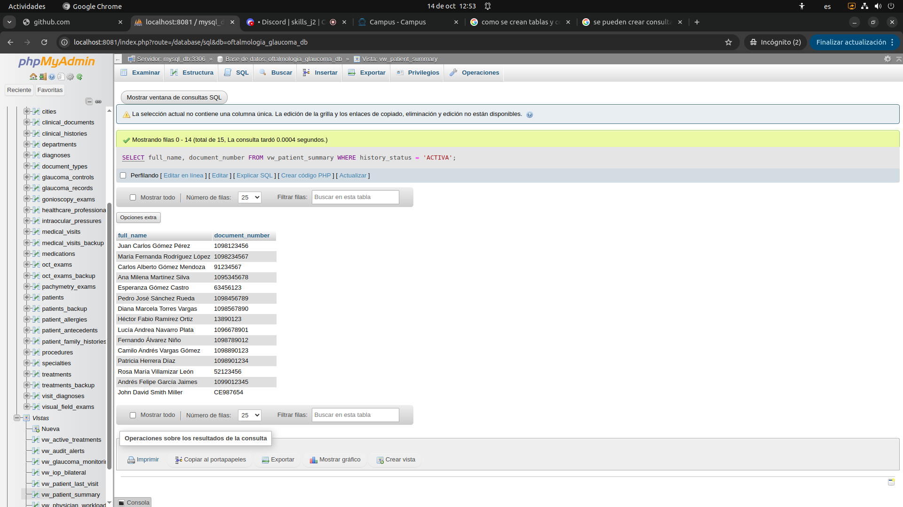
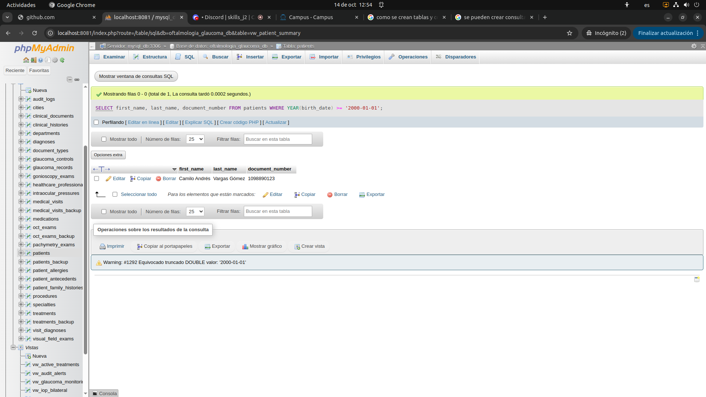
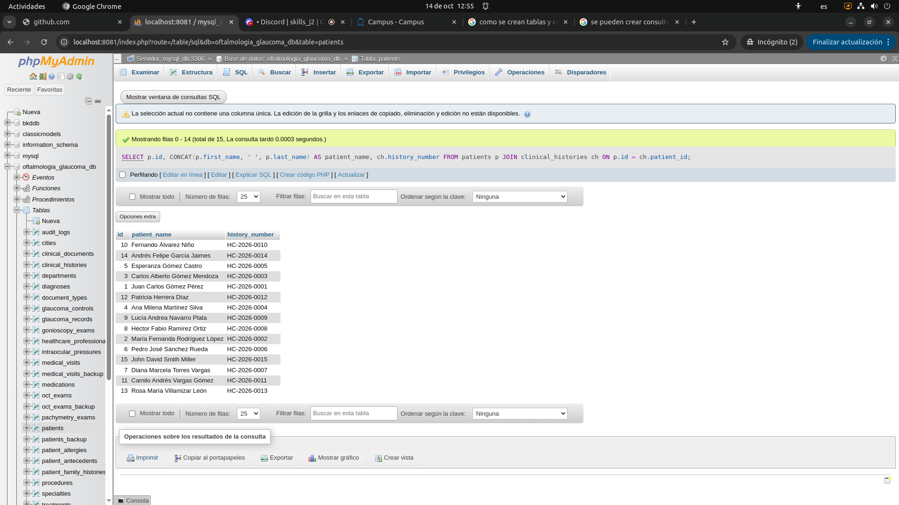
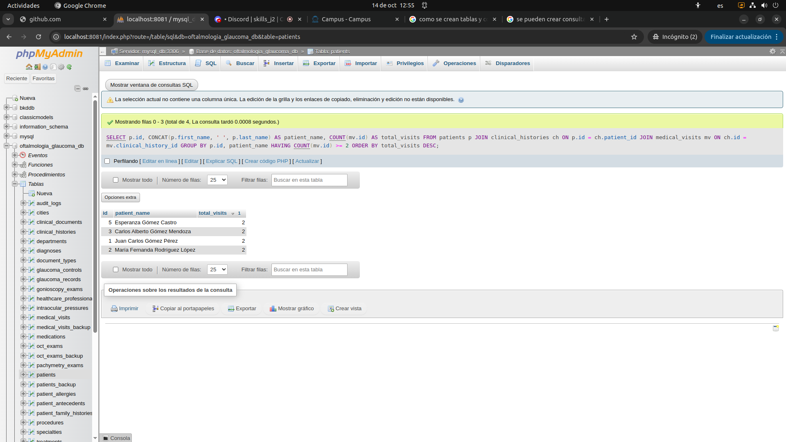
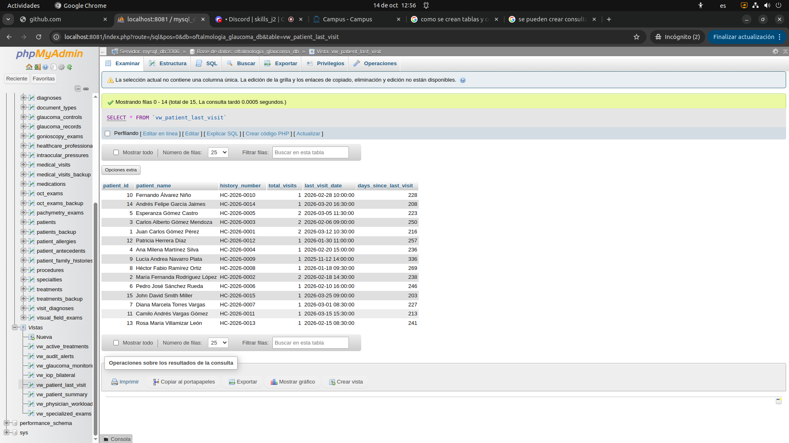
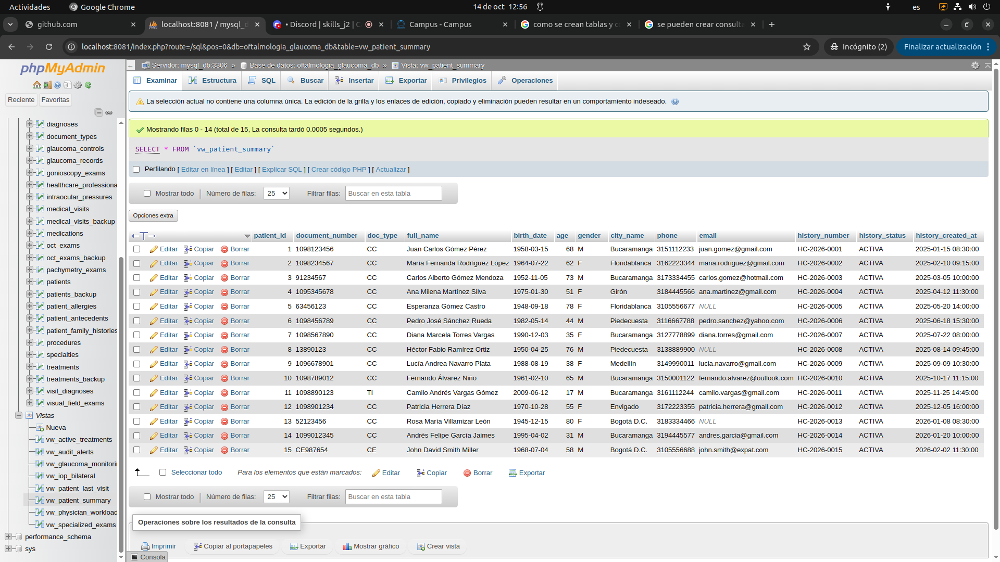
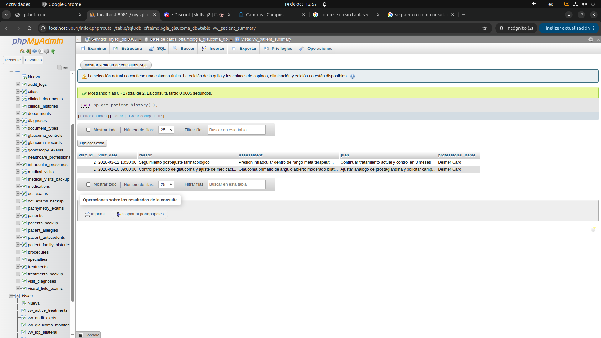

** Examen 1. Gestion de pacientes e historias clinicas

Actividad 1:
- Permite reducir la reduncia ya que persons y patients, ya que separa los datos generales de una persona con los datos especificos y necesarios para gestionar un paciente.

Actividad 2:

- obtener nombres, apellidos, y numero de identificacion de los pacientes.

SELECT document_number, first_name, last_name 
FROM patients;

- Listar los pacientes activos, ordenados alfabeticamente por apellido.

SELECT full_name, document_number
FROM vw_patient_summary
WHERE history_status = 'ACTIVA'; 

- Obtener los pacientes cuya fecha de nacimiento sea posterior al 1 de enero de 2000.

SELECT first_name, last_name, document_number
FROM patients 
WHERE YEAR(birth_date) >= '2000-01-01';

Actividad 3:

- Mostrar los nombres y apellidos de los pacientes junto con el número de su historia clínica.

SELECT p.id, CONCAT(p.first_name, ' ', p.last_name) AS patient_name, ch.history_number
FROM patients p
JOIN clinical_histories ch ON p.id = ch.patient_id;

- . Mostrar los pacientes y la cantidad total de consultas registradas, incluyendo aquellos que todavía no han sido atendidos

SELECT COUNT(*) AS total_visits_conducted 
FROM medical_visits mv;
LEFT JOIN patients p ON mv.id = p.id
LEFT JOIN patients p ON mv.id = p.id
GROUP BY mv.id, first_name;

Actividad 4:
- Obtener los pacientes que registran más de dos consultas médicas, utilizando GROUP BY y HAVING .

SELECT p.id, CONCAT(p.first_name, ' ', p.last_name) AS patient_name, COUNT(mv.id) AS total_visits
FROM patients p
JOIN clinical_histories ch ON p.id = ch.patient_id
JOIN medical_visits mv ON ch.id = mv.clinical_history_id
GROUP BY p.id, patient_name
HAVING COUNT(mv.id) >= 2
ORDER BY total_visits DESC;

- Obtener los pacientes cuya cantidad de consultas es superior al promedio de consultas por paciente, utilizando una subconsulta. Considere en el promedio también a los pacientes sin consultas.

SELECT p.id, mv.id
FROM

Activiad 5:
- en el proyecto ya esta implementado esta parte, ya que estan creadas 2 vistas (vw_patient_summary, vw_patient_last_visit) que manejan la informacion Identificador del paciente.
Nombre completo.
Número de historia clínica.
Cantidad de consultas registradas.
Fecha de la última consulta.

Actividad 6:

- . Procedimiento almacenado  

DELIMITER $$
DROP PROCEDURE IF EXISTS  sp_get_patient_history $$
CREATE PROCEDURE  sp_get_patient_history(IN p_patient_id BIGINT)
BEGIN
    SELECT mv.id AS visit_id, mv.visit_date, mv.reason, mv.assessment, mv.plan,
           CONCAT(hp.first_name, ' ', hp.last_name) AS professional_name
    FROM medical_visits mv
    JOIN clinical_histories ch ON mv.clinical_history_id = ch.id
    JOIN healthcare_professionals hp ON mv.professional_id = hp.id
    WHERE ch.patient_id = p_patient_id
    ORDER BY mv.visit_date DESC;
END $$

DELIMITER ;;

